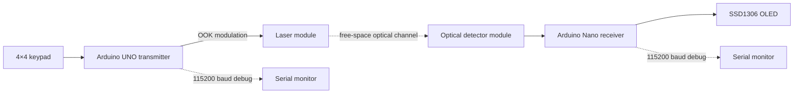

# Free-Space Optical Communication Link

**Embedded OOK laser data link: keypad → Arduino transmitter → free-space optical channel → photodetector → Arduino receiver → OLED**

This repository documents a low-cost experimental **free-space optical (FSO) communication link** built around two ATmega328P microcontrollers. Text is framed digitally, transmitted by **on-off keying (OOK)** of a laser, recovered by a digital optical receiver, decoded with timer-based bit sampling, and displayed on an OLED.

The firmware is configured for a **nominal 50 µs bit period**, corresponding to a **20 kbit/s raw optical line rate**.

## Engineering focus

The project implements the full embedded optical communication chain rather than only switching a laser on and off:

- **Digital message framing** using STX / payload / ETX
- **Asynchronous serial-style optical signaling** with start, data, and stop bits
- **OOK intensity modulation** over a free-space laser channel
- **Timer1-based 50 µs bit timing** on 16 MHz AVR microcontrollers
- **Direct-port transmitter control** to reduce timing overhead
- **Center-of-bit receiver sampling** after start-edge detection
- **Optical/electrical polarity handling** for an active-low detector module
- **Bounds, printable-character, stop-bit, and timeout checks** on the receiver
- Separation of the **optical raw bit rate** from UART debug speed and application throughput

## System architecture



The two embedded nodes exchange payload data **only through light**. No electrical data wire is required between transmitter and receiver.

## Project documentation

The repository is intended to include three visual references documenting the physical implementation:

1. `docs/setup.jpg` — complete transmitter / receiver optical setup
2. `docs/connections.jpg` — wiring and hardware connections
3. `docs/sending-timing.jpg` — transmitted optical timing / bit waveform

These images document the physical build, wiring, and timing behavior of the optical link.

## Communication protocol

Optical `1` = laser **ON**  
Optical `0` = laser **OFF**

Each byte uses an asynchronous 8N1-style frame:

| Field | Value | Duration |
| --- | --- | ---: |
| Start | `0` | 50 µs |
| Data | 8 bits, LSB first | 400 µs |
| Stop | `1` | 50 µs |
| Inter-byte idle | `1` | ≥150 µs |

Message framing:

```text
STX (0x02) → 1…16 ASCII characters → ETX (0x03)
```

Example: ASCII `H = 0x48 = 01001000₂`. Because data is transmitted LSB first, the optical data-bit order is:

```text
0 0 0 1 0 0 1 0
```

The configured raw line rate follows from the bit period:

```text
R_raw = 1 / 50 µs = 20,000 bit/s
```

## Timing implementation

Both boards run Timer1 from the 16 MHz system clock with a prescaler of 8:

```text
Timer clock = 16 MHz / 8 = 2 MHz
1 timer tick = 0.5 µs
100 ticks = 50 µs per bit
```

### Transmitter

The transmitter uses absolute timer deadlines and direct access to `PORTB` for D8. This reduces accumulated timing error compared with generating every bit using repeated high-level GPIO calls and software delays.

### Receiver

The receiver detects the idle-to-start transition and samples approximately at the center of the start bit and subsequent data/stop bits. This provides a compact software implementation of asynchronous symbol timing on the microcontroller.

## Hardware

| Qty | Component | Role |
| ---: | --- | --- |
| 1 | Arduino UNO, ATmega328P, 16 MHz | Optical transmitter controller |
| 1 | Arduino Nano, ATmega328P, 16 MHz | Optical receiver controller |
| 1 | 4×4 matrix keypad | Message input |
| 1 | Logic-controlled laser module | Optical source / OOK transmitter |
| 1 | Digital laser receiver module | Optical detection + digital thresholding |
| 1 | SSD1306 128×64 I²C OLED | Received-message display |
| — | Breadboards, jumpers, mounts, regulated supplies | Prototype hardware |

### Wiring — transmitter

| Connection | Arduino UNO |
| --- | --- |
| Laser logic input | D8 |
| Keypad R1, R2, R3, R4 | D11, D10, D9, D7 |
| Keypad C1, C2, C3, C4 | D6, D5, D4, D3 |

### Wiring — receiver

| Connection | Arduino Nano |
| --- | --- |
| Receiver OUT | D2 |
| OLED SDA | A4 |
| OLED SCL | A5 |

Wire modules by their printed labels and verify supply ratings before powering them. A bare laser diode must not be driven directly from a microcontroller I/O pin.

## Repository structure

```text
free-space-optical-communication/
├── README.md
├── .gitignore
├── transmitter/
│   └── transmitter.ino
├── receiver/
│   ├── receiver.ino
│   └── MiniOLED.h
└── docs/
    ├── setup.jpg
    ├── connections.jpg
    └── sending-timing.jpg
```

## Build and run

1. Wire and align both optical modules with power off.
2. Upload `transmitter/transmitter.ino` to a classic **Arduino UNO / ATmega328P / 16 MHz**.
3. Upload `receiver/receiver.ino` to a classic **Arduino Nano / ATmega328P / 16 MHz**. Some Nano clones require the old bootloader option.
4. Power the receiver and confirm the OLED shows `WAITING`.
5. Align the laser beam with the receiver.
6. Enter a message on the keypad and press `*` to transmit.
7. Open either Serial Monitor at **115200 baud** when debugging. This UART speed is unrelated to the optical raw bit rate.

The current keypad demo remaps physical `D → H` and `# → I`; this makes it possible to enter `HHI` with the available 4×4 keypad while keeping the optical protocol itself general for printable ASCII payload bytes.

## Current limitations

The present system is a compact educational FSO prototype. Its main limitations are:

- digital threshold receiver rather than a dedicated analog photodiode front end,
- no CRC/FEC or acknowledgement layer,
- polling-based receiver timing,
- sensitivity to optical alignment and ambient light,
- no beam tracking or atmospheric compensation.

## Relevance to Fraunhofer HHI / optical communications

Fraunhofer HHI's **Photonic Networks and Systems** activities include free-space optical communication and laser-based point-to-point links. This prototype operates at a much smaller scale, but it implements the same fundamental communication sequence:

```text
digital payload
→ framing
→ electrical drive
→ optical intensity modulation
→ free-space propagation
→ photodetection
→ timing / symbol decision
→ payload reconstruction
```

The project therefore provides practical experience with concepts directly relevant to optical transmitters and receivers, embedded timing, photodetection, free-space propagation, and digital communication systems.

## Safety

Keep the laser beam below eye level, terminate it on a matte non-reflective surface, and avoid direct eye exposure or specular reflections. Use only a laser module and supply arrangement whose ratings you have verified.

## Author

**Hossam Ahmed**  
Electronics Engineering — GIU Berlin  
Berlin, Germany · 2026
