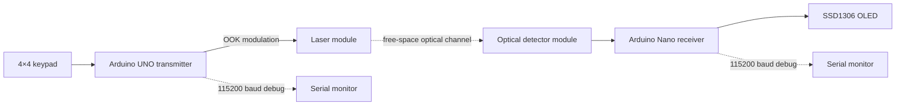

# Free-Space Optical Communication Link

**Embedded OOK laser data link: keypad → Arduino transmitter → free-space optical channel → photodetector → Arduino receiver → OLED**

This repository documents a low-cost experimental **free-space optical (FSO) communication link** built around two ATmega328P microcontrollers. Text is framed digitally, transmitted by **on-off keying (OOK)** of a laser, recovered by a digital optical receiver, decoded with timer-based bit sampling, and displayed on an OLED.

> **Project status:** end-to-end firmware and hardware prototype implemented. The firmware is configured for a **nominal 50 µs bit period (20 kbit/s raw line rate)**. Precise bit timing, packet-error rate, range, and environmental robustness are intentionally listed as measurements still to be characterized rather than claimed as verified results.

## Engineering focus

This is more than a laser-on/laser-off demonstration. The implementation explores the complete embedded communication chain:

- **Digital message framing** using STX / payload / ETX
- **Asynchronous serial-style optical signaling** with start, data, and stop bits
- **OOK intensity modulation** over a free-space laser channel
- **Timer1-based 50 µs bit timing** on 16 MHz AVR microcontrollers
- **Direct-port transmitter control** to reduce timing overhead
- **Center-of-bit receiver sampling** after start-edge detection
- **Optical/electrical polarity handling** for an active-low detector module
- **Bounds, printable-character, stop-bit, and timeout checks** on the receiver
- Separation of the **optical raw bit rate** from UART debug speed and application throughput

## System architecture



The two embedded nodes exchange payload data **only through light**. No electrical data wire is required between transmitter and receiver.

## Communication protocol

Optical `1` = laser **ON**  
Optical `0` = laser **OFF**

Each byte uses an asynchronous 8N1-style frame:

| Field | Value | Duration at configured timing |
| --- | --- | ---: |
| Start | `0` | 50 µs |
| Data | 8 bits, LSB first | 400 µs |
| Stop | `1` | 50 µs |
| Inter-byte idle | `1` | ≥150 µs |

Message framing:

```text
STX (0x02) → 1…16 ASCII characters → ETX (0x03)
```

Example: ASCII `H = 0x48 = 01001000₂`. Because data is transmitted LSB first, the optical data-bit order is:

```text
0 0 0 1 0 0 1 0
```

The configured raw line rate follows directly from the bit period:

```text
R_raw = 1 / 50 µs = 20,000 bit/s
```

This is a **nominal timing target**, not yet a measured channel-capacity or error-free throughput claim.

## Timing implementation

Both boards run Timer1 from the 16 MHz system clock with a prescaler of 8:

```text
Timer clock = 16 MHz / 8 = 2 MHz
1 timer tick = 0.5 µs
100 ticks = 50 µs per bit
```

### Transmitter

The transmitter uses absolute timer deadlines and direct access to `PORTB` for D8. This avoids accumulating the software overhead that would occur if each bit were generated using repeated `digitalWrite()` and `delayMicroseconds()` calls.

### Receiver

The receiver detects the idle-to-start transition, then samples approximately at the center of the start bit and each subsequent data/stop bit. This is a compact software implementation of asynchronous timing recovery; it does **not** replace a PLL/CDR or oversampling receiver used in higher-performance links.

## Hardware

| Qty | Component | Role |
| ---: | --- | --- |
| 1 | Arduino UNO, ATmega328P, 16 MHz | Optical transmitter controller |
| 1 | Arduino Nano, ATmega328P, 16 MHz | Optical receiver controller |
| 1 | 4×4 matrix keypad | Message input |
| 1 | Logic-controlled laser module | Optical source / OOK transmitter |
| 1 | Digital laser receiver module | Optical detection + digital thresholding |
| 1 | SSD1306 128×64 I²C OLED | Received-message display |
| — | Breadboards, jumpers, mounts, regulated supplies | Prototype hardware |

### Wiring — transmitter

| Connection | Arduino UNO |
| --- | --- |
| Laser logic input | D8 |
| Keypad R1, R2, R3, R4 | D11, D10, D9, D7 |
| Keypad C1, C2, C3, C4 | D6, D5, D4, D3 |

### Wiring — receiver

| Connection | Arduino Nano |
| --- | --- |
| Receiver OUT | D2 |
| OLED SDA | A4 |
| OLED SCL | A5 |

Wire modules by their printed labels and verify supply ratings before powering them. A bare laser diode must not be driven directly from a microcontroller I/O pin.

## Repository structure

```text
free-space-optical-communication/
├── README.md
├── .gitignore
├── transmitter/
│   └── transmitter.ino
├── receiver/
│   ├── receiver.ino
│   └── MiniOLED.h
└── docs/
    ├── engineering-notes.md
    └── verification-plan.md
```

## Build and run

1. Wire and align both optical modules with power off.
2. Upload `transmitter/transmitter.ino` to a classic **Arduino UNO / ATmega328P / 16 MHz**.
3. Upload `receiver/receiver.ino` to a classic **Arduino Nano / ATmega328P / 16 MHz**. Some clones require the old bootloader option.
4. Power the receiver and confirm the OLED shows `WAITING`.
5. Align the laser beam with the receiver.
6. Enter a message on the keypad and press `*` to transmit.
7. Open either Serial Monitor at **115200 baud** when debugging. This UART speed is unrelated to the optical raw bit rate.

The current keypad demo remaps physical `D → H` and `# → I`; this makes it possible to enter `HHI` with the available 4×4 keypad while keeping the optical protocol itself general for printable ASCII payload bytes.

## Verification strategy

A professional communication prototype should report measurements, not only successful screenshots. The next characterization stage is defined explicitly in [`docs/verification-plan.md`](docs/verification-plan.md):

- measure transmitter D8 and receiver OUT timing with an oscilloscope / logic analyzer,
- verify the configured 50 µs bit period,
- run repeated packet tests with changing payloads,
- record packet success/error statistics,
- sweep distance and alignment,
- compare bright-room and low-ambient-light operation,
- characterize failure behavior when the beam is partially or fully blocked.

This separates **implemented design** from **measured performance**.

## Engineering limitations

The present system is deliberately simple and should not be confused with a research-grade optical modem. Current limitations include:

- digital threshold receiver rather than a characterized photodiode + analog front end,
- no measured optical power or link budget,
- no CRC/FEC, acknowledgement, or automatic retransmission,
- no measured BER/PER curve,
- polling-based start detection with finite software latency,
- no oversampling or clock-recovery loop,
- sensitivity to alignment, receiver bandwidth, ambient light, and module threshold,
- no beam tracking or atmospheric compensation,
- application-level 150 ms pause after a packet to allow OLED refresh.

## Research-oriented next steps

The most valuable upgrades are not cosmetic. They turn the prototype into a more meaningful communications experiment:

1. **Automated packet generator + CRC-8** to measure packet-error rate instead of judging the OLED visually.
2. **Photodiode + transimpedance amplifier (TIA)** to expose the analog optical waveform rather than hiding it behind a digital module comparator.
3. **Oscilloscope characterization** of rise/fall time, jitter, eye opening, and receiver threshold margin.
4. **Rate sweep** to determine the maximum reliable link rate for the actual optical hardware.
5. **Distance/alignment sweep** to quantify geometric loss and sensitivity.
6. **Ambient-light tests and optical filtering** to evaluate interference rejection.
7. **Link-budget model** using measured source power, geometry, detector responsivity/sensitivity, and receiver noise.
8. **Hardware-timer / interrupt or capture-based receiver architecture** for lower timing uncertainty.

## Relevance to Fraunhofer HHI / optical communications

Fraunhofer HHI's **Photonic Networks and Systems** department includes research on **free-space optical systems** and laser-based point-to-point communication links. This prototype is intentionally much simpler and many orders of magnitude slower, but it exercises the same fundamental end-to-end chain at educational scale:

```text
digital payload
→ framing
→ electrical drive
→ optical intensity modulation
→ free-space propagation
→ photodetection
→ timing/symbol decision
→ payload reconstruction
```

That makes the project useful preparation for deeper work in optical transmitters/receivers, detector front ends, communication measurements, DSP, and link characterization.

See also: [`docs/engineering-notes.md`](docs/engineering-notes.md)

## Safety

Keep the laser beam below eye level, terminate it on a matte non-reflective surface, and avoid direct eye exposure or specular reflections. Use only a laser module and supply arrangement whose ratings you have verified.

## Author

**Hossam Ahmed**  
Electronics Engineering — GIU Berlin  
Berlin, Germany · 2026
