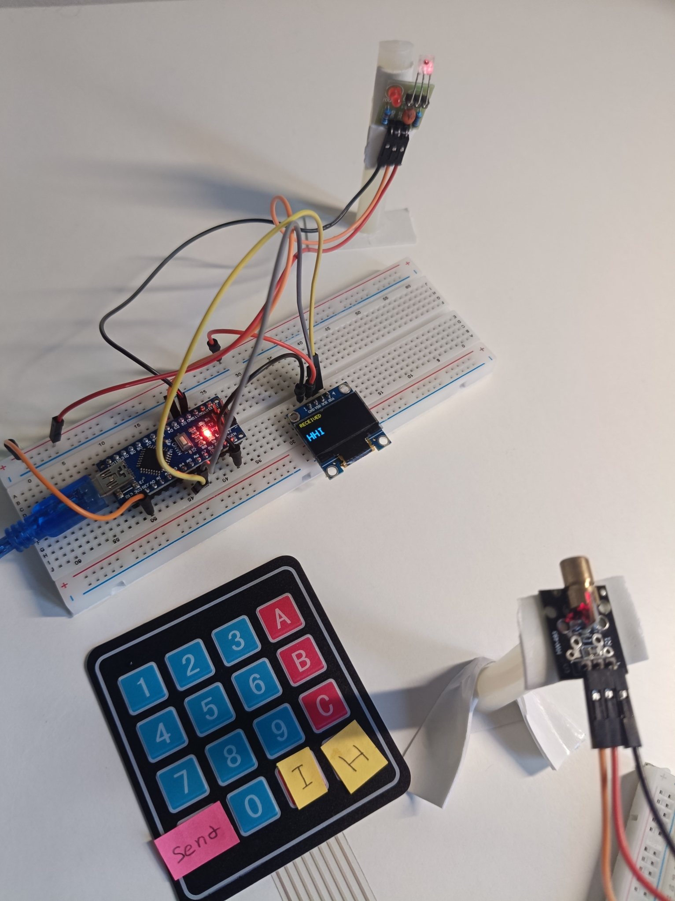

# Free-Space Optical Communication Link

A small free-space optical link I built to send text between two Arduino boards using a laser as the communication channel.

The transmitter reads a message from a 4×4 keypad, sends it using on-off keying (OOK), and the receiver reconstructs the bytes and shows the result on an OLED.



## What it does

- sends text through free space using a laser
- uses OOK: laser ON = `1`, laser OFF = `0`
- frames each message with STX and ETX bytes
- sends each byte as start bit + 8 data bits + stop bit
- samples received bits near their center
- displays the received message on a 128×64 OLED

The firmware uses a nominal bit time of **50 µs**, which corresponds to a raw line rate of **20 kbit/s**.

## Hardware

- Arduino UNO — transmitter
- Arduino Nano — receiver
- 4×4 matrix keypad
- logic-controlled laser module
- digital optical receiver module
- SSD1306 128×64 OLED

### Connections


Transmitter:

| Connection | Arduino UNO |
| --- | --- |
| Laser input | D8 |
| Keypad rows | D11, D10, D9, D7 |
| Keypad columns | D6, D5, D4, D3 |

Receiver:

| Connection | Arduino Nano |
| --- | --- |
| Optical receiver output | D2 |
| OLED SDA | A4 |
| OLED SCL | A5 |

## Protocol

A complete message is sent as:

```text
STX → payload → ETX
```

Each byte uses an 8N1-style optical frame:

```text
start bit | 8 data bits, LSB first | stop bit
    0     |       b0 ... b7        |    1
```

For example, `H` is `0x48`. Its eight data bits are transmitted LSB first as:

```text
0 0 0 1 0 0 1 0
```

There is also a short idle gap between bytes.

## Timing

Both boards use Timer1 with a prescaler of 8:

```text
16 MHz / 8 = 2 MHz timer clock
1 timer tick = 0.5 µs
100 ticks = 50 µs per bit
```

The transmitter drives D8 directly through the AVR port register during a byte so software overhead does not accumulate between bits. The receiver detects the start edge and samples near the middle of each bit.


## Code

The main sketches are intentionally kept short. Hardware-specific code is separated into small headers.

```text
transmitter/
├── transmitter.ino
├── OpticalTx.h
└── Keypad4x4.h

receiver/
├── receiver.ino
├── OpticalRx.h
└── MiniOLED.h
```

- `transmitter.ino` handles the message and keypad interaction.
- `OpticalTx.h` contains the Timer1 optical transmit timing.
- `Keypad4x4.h` contains the keypad scan code.
- `receiver.ino` handles framing and the received message.
- `OpticalRx.h` contains start-edge detection and bit sampling.
- `MiniOLED.h` is the small local SSD1306 driver used by the receiver.

The code targets the classic **16 MHz ATmega328P UNO/Nano**.

## Running the project

1. Upload `transmitter/transmitter.ino` to the UNO.
2. Upload `receiver/receiver.ino` to the Nano.
3. Align the laser with the optical receiver.
4. Type a message on the keypad.
5. Press `*` to send it.
6. The received text appears on the OLED.

For the demo keypad, `D` is used as `H` and `#` as `I`, which makes it possible to type `HHI` without adding a separate keyboard interface.

Serial output at **115200 baud** is only used for debugging; it is separate from the optical bit rate.

## Current limits

This is a simple one-way prototype. The receiver module already converts the optical signal to a digital level, so the analog photodiode signal is not exposed. The link also has no CRC or acknowledgement and still depends on optical alignment and ambient-light conditions.

A useful next version would replace the digital receiver module with a photodiode and transimpedance amplifier so the analog received signal can also be measured.

## Author

**Hossam Ahmed**  
Electronics Engineering — GIU Berlin  
Berlin, Germany · 2026
