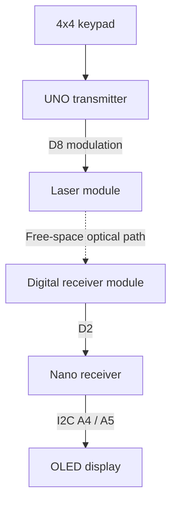
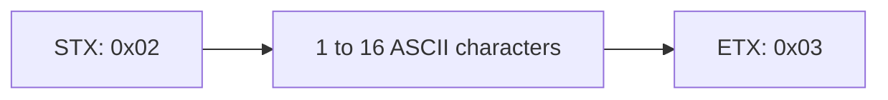

# Free-Space Optical Communication

A keypad-controlled laser link that sends text from an Arduino UNO to an Arduino Nano over free space. The receiver reconstructs the message and displays it on an OLED.

**Target: nominal 20 kbit/s raw optical bit rate (50 µs per bit).** This version uses Timer1-based timing on both boards. Hardware reliability and actual bit timing at this rate still need verification; the photograph shows the existing prototype, not a measured 20 kbit/s result.

## Features

- Enter up to 16 characters, then press `*` to transmit.
- Press `*` with an empty input buffer to repeat the last transmitted message.
- Physical `D` types `H`; physical `#` types `I`. There is no delete key.
- On-off keying (OOK), 8-bit characters, STX/ETX message framing.
- Large OLED text using the included lightweight driver.
- No data wire between the transmitter and receiver.

## Files

| File | Purpose |
| --- | --- |
| `transmitter/transmitter.ino` | UNO keypad scanning, message buffer and optical transmission |
| `receiver/receiver.ino` | Nano optical decoding and message handling |
| `receiver/MiniOLED.h` | Included SSD1306 OLED driver, adapted from the original sketch |

## Requirements

| Quantity | Component |
| --- | --- |
| 1 | Classic Arduino UNO, ATmega328P, 16 MHz, 5 V |
| 1 | Classic Arduino Nano, ATmega328P, 16 MHz, 5 V |
| 1 | 4×4 matrix keypad |
| 1 | Laser transmitter module with suitable logic-control input (existing HW-493 setup) |
| 1 | Digital laser receiver module: output LOW under illumination, HIGH when dark |
| 1 | SSD1306 128×64 I²C OLED, address `0x3C`, with supply/logic compatibility for this wiring |
| As needed | Breadboards, jumper wires, USB cables, regulated supplies and stable mounts |

Software: Arduino IDE with **Arduino AVR Boards**. `Wire` and AVR headers come with the board core; no Keypad or Adafruit library is required. Keep `MiniOLED.h` beside `receiver.ino`.

This code is specific to classic 16 MHz ATmega328P boards. It is not for Nano Every, UNO R4, ESP32 or STM32. Timer1 is reserved for the link; do not add Servo or other Timer1 users.

## Wiring / connection schematic

*Illustrative overview: follow the pin names in the wiring tables below; drawn connector positions are not a physical pinout. The image’s “stable demo” label does not establish hardware verification of this firmware.*

Wire by the module's printed labels, not by wire color or assumed connector order. Confirm module voltage ratings. A bare laser diode must not be powered directly from D8; use a properly rated driver if the module does not provide a logic-control input.

### Transmitter — UNO

| Component connection | UNO connection |
| --- | --- |
| Laser logic input / S | D8 |
| Laser supply | Rated supply for the module; 5 V only if specified |
| Laser GND | GND |
| Keypad R1, R2, R3, R4 | D11, D10, D9, D7 respectively |
| Keypad C1, C2, C3, C4 | D6, D5, D4, D3 respectively |

### Receiver — Nano

| Component connection | Nano connection |
| --- | --- |
| Receiver OUT | D2 |
| Receiver VCC | 5 V, for a 5 V-rated receiver |
| Receiver GND | GND |
| OLED SDA | A4 |
| OLED SCL | A5 |
| OLED VCC | 5 V only for a compatible OLED module |
| OLED GND | GND |

Each module shares ground with its own Arduino. The optical link requires no ground or data connection between the two boards. Powering both from the same computer may still connect their grounds through USB; use separate isolated power sources when demonstrating electrical independence.

This is a module-level wiring guide, not a schematic of the electronics inside the laser or receiver modules. Keep the beam below eye level, terminate it on a matte surface, and avoid eyes and reflective objects.

## Setup

1. Wire both sides with power off, then align and securely mount the optical modules.
2. Open `transmitter/transmitter.ino`; select **Arduino Uno** and its port, then upload.
3. Open `receiver/receiver.ino`; select **Arduino Nano → ATmega328P** and its port, then upload. Some Nano clones require **ATmega328P (Old Bootloader)**.
4. Power the receiver and wait for `WAITING`. Align the laser with its detector. The laser stays on while idle.
5. Press physical `D`, `D`, `#`, then `*`. The receiver should show `HHI`.
6. Type `123A`, then `*`. Press `*` again to resend it. The previous message is remembered only until transmitter reset/power loss.
7. Optional: open Serial Monitor at **115200 baud** for diagnostics. This UART speed is separate from the optical bit rate.

**Upload both new sketches.** The old receiver with `bitDuration = 1000` cannot decode this 50 µs version.

## Protocol and frame diagram

*Nominal 50 µs bit timing; hardware verification remains pending for this firmware.*

Optical `1` = laser ON; optical `0` = laser OFF. The receiver module electrically inverts this, so the Nano reverses it in software.

Every byte, including STX and ETX, has the following layout:

| Order | Start | Data | Stop | Inter-byte idle |
| --- | --- | --- | --- | --- |
| Value | 0 | b0, b1, b2, b3, b4, b5, b6, b7 | 1 | 1 |
| Duration | 50 µs | 8 × 50 µs | 50 µs | At least 150 µs |

Data is **least significant bit first**. For example, `H` = `0x48`, so its transmitted data bits are `0 0 0 1 0 0 1 0`. `HHI` is sent as `0x02 0x48 0x48 0x49 0x03`.

Timer1 runs at 2 MHz (16 MHz clock divided by 8), giving 100 timer ticks per bit. Absolute deadlines avoid the cumulative overhead of repeated `digitalWrite()` plus `delayMicroseconds()` calls. Interrupts are paused during each byte; receive start detection is polled, so timing still has finite latency and clock error.

20 kbit/s describes the raw bit periods, **not payload throughput**. Each byte occupies approximately 650 µs including its gap; a 16-character message plus two markers takes approximately 11.7 ms, before additional software overhead. A deliberate 150 ms transmitter pause allows the receiver to refresh its OLED.

## Simple verification

| Test | What to check |
| --- | --- |
| First press of `*` after reset | No previous message: nothing is transmitted |
| `HHI`, `123A`, `0123456789ABCHI0` | Exact received characters and order |
| `0123456789ABCHI01` | Full 16-character message; a 17th key is ignored |
| Empty-buffer `*` | Repeats the most recently transmitted text |
| Block beam with an opaque card during a send | Message may be lost, partial or corrupted; old display may remain |
| Restore beam, press `*` | Message is received again |
| Repeat at least 100 transmissions | Record correct, missing and wrong messages, distance and lighting |
| Oscilloscope / logic analyzer, if available | Measure approximately 50 µs bit intervals at D8 and receiver OUT |

For repeated identical messages, count receiver Serial lines as well as inspecting the screen: unchanged OLED text does not prove another packet arrived. Use changing messages to expose missed updates.

## Limitations and next steps

This is a one-way demonstration link: no CRC/checksum, acknowledgement, automatic retry or measured bit-error rate. Start/stop checks, bounds checks and a partial-message timeout reject some malformed input, but **do not guarantee data integrity**. “Transmitted” means the UNO emitted the packet, not that the Nano received it.

The receiver refreshes the display after ETX and cannot listen during that update; use the included transmitter's pause. Range and maximum reliable rate depend on alignment, ambient light, module bandwidth and power quality. If 20 kbit/s fails, first inspect the receiver waveform. To try 10 kbit/s, set `BIT_TICKS = 200` in **both** sketches; verify again and report the rate actually tested.

Useful future improvements: CRC-8, sequence numbers, automatic test packets and measured packet-error rate versus distance and alignment.
